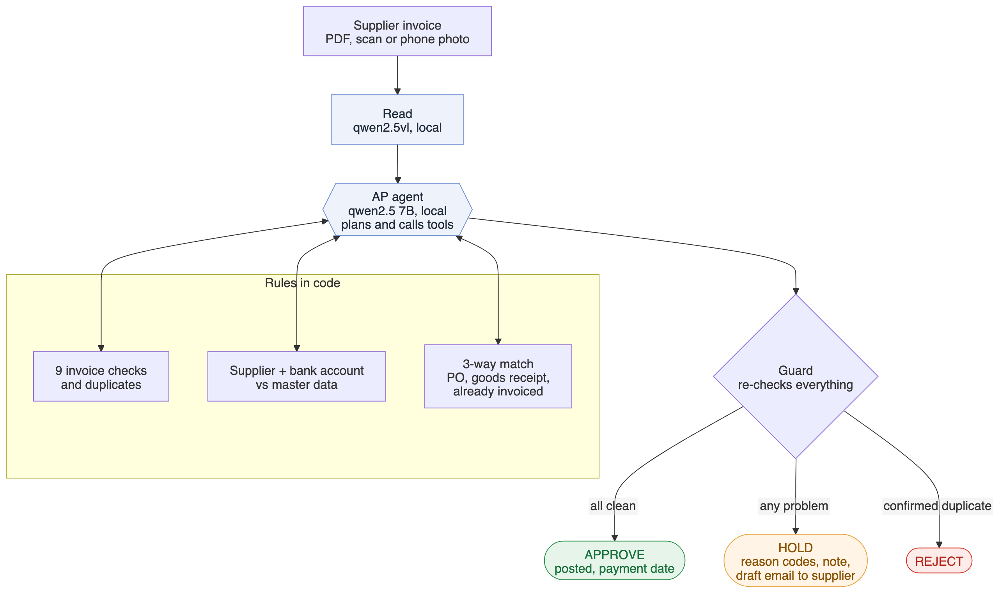
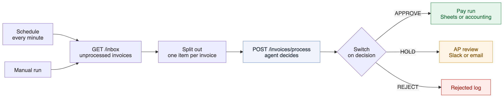

# Invoice Agent AI

Supplier invoices checked against the **purchase order** and the **goods receipt** by an AI agent, before anything is paid. Each invoice is approved, put on hold with reasons, or rejected, and every step is logged. Runs on your own machine: a local model on Ollama, an n8n workflow for the inbox, and an MCP server so you can ask about any case from Claude Desktop.

The model plans and explains. Code enforces the money rules. A person decides on anything uncertain.

<p align="center">
<picture>
  <source media="(prefers-color-scheme: dark)" srcset="docs/diagrams/system-dark.png">
  
</picture>
</p>

## Why this problem

Before an accounts payable team pays a supplier, someone does the **3-way match**: does the invoice agree with what was ordered (the PO) and with what actually arrived (the goods receipt)? The costly mistakes are quiet ones:

- a price a few percent above the PO
- 50 units billed when 40 arrived
- an invoice that was already paid last month, sent again
- a supplier whose bank account "changed" (the classic payment fraud)
- an invoice with no PO number, or a misprinted one

Reading the invoice is the easy part. Finding the right records, comparing them line by line and explaining the decision is the work. That is what this agent does.

RESULTS_PLACEHOLDER

## How it decides

The agent is a tool-calling loop (qwen2.5 7B on Ollama by default). It follows an AP procedure in its system prompt and calls these tools:

| Tool | What it returns |
|---|---|
| `read_invoice` | supplier, tax ID, invoice number, dates, totals, PO number, bank account (masked), line items |
| `check_invoice` | Private Invoice AI's 9 checks (line maths, tax, totals, dates, required fields, tax ID) and duplicates against paid invoices |
| `find_supplier` | the supplier master record, by tax ID first, then name |
| `verify_bank_account` | whether the bank account on the invoice is the one on file |
| `get_purchase_order` / `search_purchase_orders` | one PO, or the supplier's open POs |
| `get_goods_receipts` | ordered, received and already invoiced per PO line |
| `three_way_match` | line-by-line comparison: quantity billed ≤ received minus already invoiced, unit price within 2% of the PO, every line on the PO |
| `draft_email_to_supplier` | a draft to the address **on file** (never the one on the invoice); nothing is sent |
| `approve_for_payment` / `hold_for_review` / `reject_invoice` | end the case |

**The guard.** `approve_for_payment` re-runs every check in code before it posts anything: supplier on file, bank account matches, invoice checks pass, not a duplicate, the PO exists, belongs to the supplier, is open, every line matches, quantities and prices are within limits. If the invoice gives no valid PO number, it is only approved when exactly one open PO of that supplier matches. If anything fails, the tool refuses and returns the reasons, and the agent has to hold the invoice. `reject_invoice` only works for a confirmed duplicate. The report counts these refusals as **guard blocks**, so you can see how often the model tried something unsafe.

**Why an agent and not a script?** The money decision follows fixed rules, and code enforces them; that is what makes it safe to use a 7B model on your own machine. The model does the parts that rules handle badly: choosing which records to pull, finding the right PO when the reference is missing or misprinted, writing the note for the reviewer and the email to the supplier, and answering questions about a case in chat (MCP). The same tools work in a batch, behind n8n, and in Claude Desktop.

## n8n workflow

<p align="center">
<picture>
  <source media="(prefers-color-scheme: dark)" srcset="docs/diagrams/n8n-dark.png">
  
</picture>
</p>

`n8n/invoice-agent.workflow.json`: every minute, take the new invoices from the inbox, let the agent decide, route by decision. The three end nodes are placeholders for your tools (Google Sheets or the accounting system for the pay run, Slack or email for the review queue).

```bash
uv run uvicorn invoice_agent_ai.api:app --port 8000     # the agent behind HTTP
# n8n: Workflows > Import from file > n8n/invoice-agent.workflow.json
# (n8n in Docker: replace 127.0.0.1 with host.docker.internal)
```

N8N_TEST_PLACEHOLDER

API: `GET /inbox`, `POST /invoices/process {"file": "inv_007.pdf"}`, `GET /cases/{id}` (full audit trail), `GET /review-queue`, `GET /postings`, `GET /drafts`, `POST /reset`.

## MCP server (Claude Desktop or any MCP client)

```json
{
  "mcpServers": {
    "invoice-agent": {
      "command": "uv",
      "args": ["--directory", "/path/to/invoice-agent-ai", "run", "python", "-m", "invoice_agent_ai.mcp_server"],
      "env": {"AGENT_DATA": "data/dev", "AGENT_WORKSPACE": "out/live"}
    }
  }
}
```

Tools: `list_inbox`, `process_invoice`, `get_case`, `review_queue`, `approved_for_payment`, `purchase_order`, `supplier_open_orders`. Ask: *"Process the new invoices"*, *"Why is inv_014 on hold?"*, *"What is still open on PO-2026-4098?"*. Tested over stdio with the official MCP Python SDK (`tests/test_service.py`).

## Run it

```bash
# 1. local models
ollama pull qwen2.5vl       # reads the invoices
ollama pull qwen2.5:7b      # the agent

# 2. install (pulls Private Invoice AI from GitHub as a dependency)
uv sync

# 3. a batch: synthetic ERP + 24 invoices + ground truth
uv run python -m invoice_agent_ai generate --set dev --seed 11
uv run python -m invoice_agent_ai extract --set dev        # read each invoice once (cached)
uv run python -m invoice_agent_ai run --set dev            # the agent
uv run python -m invoice_agent_ai run --set dev --mode rules   # baseline: policy in code, no LLM

# 4. review screen
uv run streamlit run app.py -- --set dev

# other models: any OpenAI-compatible endpoint
uv run python -m invoice_agent_ai run --set dev --llm openai --base-url https://openrouter.ai/api/v1 --model <model-id>

# tests (no model needed)
uv run pytest -q
```

## How the test data is made

`synth.py` builds a small ERP for each batch: 9 suppliers (one more supplier sends invoices but is not on file), their purchase orders and goods receipts, plus paid-invoice history. Then 24 supplier invoices in Private Invoice AI's four layouts (US, French, UK, Moroccan) with the PO reference and the bank account printed, about 30% degraded into phone photos:

| Scenario | Per batch | Expected |
|---|---|---|
| clean (some bill a partial delivery exactly as received) | 7 | approve |
| no PO number on the invoice, one open PO fits | 2 | approve, agent finds the PO |
| misprinted PO number | 1 | approve, agent finds the PO |
| unit price above the PO | 2 | hold `price_variance` |
| billed more than received | 2 | hold `qty_variance` |
| goods not received | 1 | hold `not_received` |
| bank account differs from the one on file | 2 | hold `bank_mismatch` |
| already paid last month | 2 | reject `duplicate` |
| total, tax or line amount wrong | 2 | hold `invoice_check_failed` |
| supplier not on file | 1 | hold `unknown_supplier` |
| no PO number, two identical open POs | 1 | hold `po_ambiguous` |
| PO of another supplier | 1 | hold `po_mismatch` |

Before anything is written, every scenario is run through the payment policy on a perfectly read invoice, in inbox order, and must give its intended answer. Synthetic data keeps the repo free of anyone's real invoices; real documents are messier, so a real project starts with a test on yours.

## Layout

```
src/invoice_agent_ai/
  synth.py        synthetic ERP, invoices (PDF / photo) and ground truth
  extract.py      local reading: Private Invoice AI's extractor + PO number + bank account
  erp.py          master data, postings, review queue, drafts
  match.py        3-way match, payment policy (the guard's single source of truth)
  tools.py        tool schemas + functions, guarded actions
  agent.py        tool-calling loop (Ollama or OpenAI-compatible), audit trail, fallbacks
  evaluate.py     decisions, reasons, PO matching, safety, extraction vs ground truth
  pipeline.py     batch runs
  service.py      one live AP desk shared by the API and the MCP server
  api.py          FastAPI for n8n
  mcp_server.py   MCP server
n8n/              n8n workflow
app.py            Streamlit review screen
results/          reports of the runs quoted above
```

Builds on [Private Invoice AI](https://github.com/SaidIbenariba/private-invoice-ai) (installed from GitHub at a pinned commit) for reading invoices and the 9 invoice checks.

## Author

Said Ibenariba, data scientist and AI engineer. I took a vision-language invoice model to production at Orange Business (1,000+ carrier invoice formats, FastAPI + Docker, air-gapped). Available for AI automation and document-processing projects: [hire me on Upwork](https://www.upwork.com/freelancers/~01940599324880c3de).
